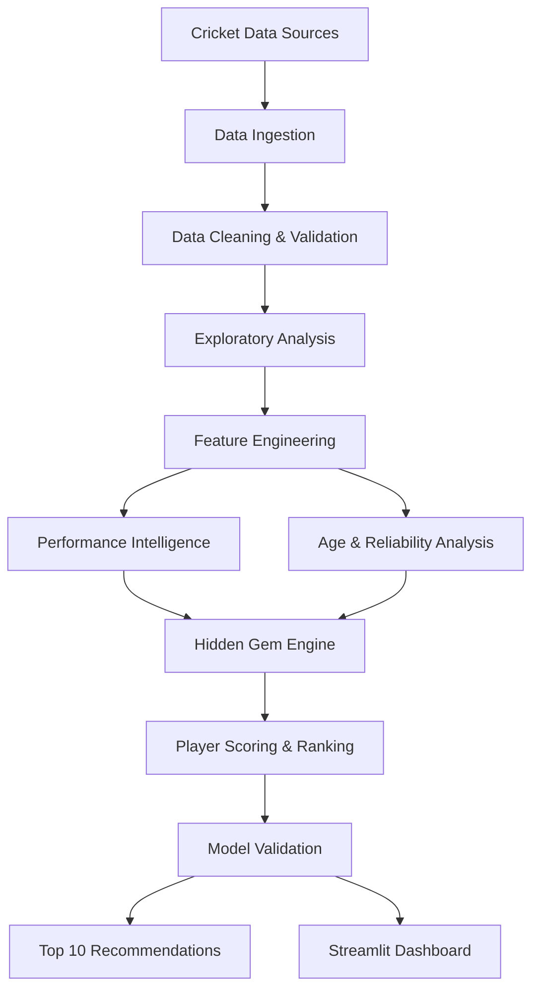

# 💎 RR GemHunters

\<h3 align="center">🏏 Others See Stats. We Discover Stars.\</h3>

\<p align="center">
&#x20; \<strong>Cricket Talent Discovery & Auction Intelligence\</strong>
\</p>

\<p align="center">
&#x20; \
&#x20; \
&#x20; \
&#x20; \
&#x20; \
\</p>

---

## 🎯 About

**RR GemHunters** is a data-driven cricket scouting intelligence project developed around the *SupeRR Selector Season 2* challenge by Rajasthan Royals.

Our mission is to identify promising young uncapped domestic players by going beyond conventional cricket statistics.

We combine statistical analysis, T20 performance intelligence and role-based evaluation to discover overlooked cricketing talent.

## 💎 Our Signature Innovation

### Hidden Gem Detection Engine

Discover players whose context-adjusted scouting value is stronger than their conventional ranking suggests.

**Oversight Gap:**

[
OG = R\_{conventional} - R\_{adjusted}
]

We investigate why a player's ranking changes, considering performance, age, role and statistical reliability.

## 🚀 Key Features

| Feature                     | Purpose                                          |
| --------------------------- | ------------------------------------------------ |
| 📊 Performance Intelligence | Batting and bowling evaluation                   |
| ⚡ T20 Phase Intelligence    | Powerplay, middle and death overs                |
| 🎯 Age-Adjusted Potential   | Evaluate emerging young talent                   |
| 📈 Consistency Engine       | Performance reliability and sample-size analysis |
| 💎 Hidden Gem Detection     | Identify potentially overlooked players          |
| 🧠 Player Archetypes        | Discover tactical player profiles                |
| ⚖️ Smart Comparison         | Compare players using role-specific metrics      |
| 🏏 RR Strategic Fit         | Evaluate potential squad contribution            |
| 🔬 Model Validation         | Confidence and ranking robustness                |
| 📉 Scouting Dashboard       | Interactive player analytics                     |

## 🧮 Statistical Framework

- Descriptive Statistics & Percentiles
- Z-Score & Feature Normalization
- Bayesian Shrinkage
- Weighted Scoring
- Correlation Analysis
- K-Means Clustering
- Sensitivity Analysis

**Initial scoring hypothesis:**

| Evaluation Dimension         | Weight |
| ---------------------------- | -----: |
| Context-adjusted performance |    25% |
| Phase-specific impact        |    20% |
| Age-adjusted potential       |    15% |
| Consistency & reliability    |    15% |
| Role-specific value          |    15% |
| Development indicators       |    10% |

*Weights are provisional and will be validated against the available data.*

## 🏗️ System Architecture



## 🛠️ Tech Stack

`Python` · `Pandas` · `NumPy` · `SciPy` · `Scikit-learn` · `Matplotlib` · `Seaborn` · `Plotly` · `Streamlit` · `Jupyter` · `Git` · `GitHub`

## 📂 Project Structure

```text
RR-GemHunters/
├── data/
├── notebooks/
├── src/
│   ├── data/
│   ├── preprocessing/
│   ├── features/
│   ├── analytics/
│   ├── scoring/
│   └── evaluation/
├── dashboard/
├── reports/
├── tests/
├── config/
├── .gitignore
├── requirements.txt
└── README.md
```

## 📍 Development Roadmap

- [x] Project initialization
- [x] Python environment setup
- [x] Core dependencies installation
- [ ] GitHub integration
- [ ] Data investigation & cleaning
- [ ] Exploratory data analysis
- [ ] Cricket feature engineering
- [ ] Hidden Gem Detection Engine
- [ ] Statistical scoring & validation
- [ ] Interactive dashboard
- [ ] Final scouting recommendations

## 🔐 Data Privacy

Official competition datasets, confidential player-level records and restricted derived findings will not be published. Only materials permitted by the competition rules will be shared.

## 👨‍💻 Developer

**Ankan Sen** | B.Tech CSE

[GitHub Profile](https://github.com/AnkanXcoder)

---

\<p align="center">
&#x20; \<strong>💎 Every Hidden Gem Deserves a Chance to Shine.\</strong>
&#x20; \<br/>
&#x20; \<sub>RR GemHunters | Discovering Tomorrow's Cricket Stars\</sub>
\</p>
