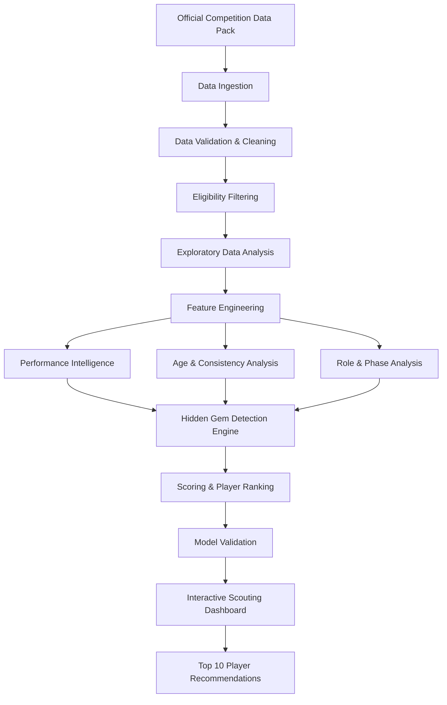

# 💎 RR GemHunters

<p align="center">
  <h3 align="center">Others See Stats. We Discover Stars.</h3>
  <p align="center">
    <strong>Cricket Talent Discovery & Auction Intelligence</strong>
    <br />
    An analytical scouting platform designed to identify undervalued, young and high-potential domestic cricket talent.
  </p>
</p>

<p align="center">
  
  
  
  
  
</p>

---

## 🎯 About the Project

**RR GemHunters** is a data-driven cricket scouting and auction intelligence project developed for **SupeRR Selector Season 2**.

The goal is to go beyond conventional cricket statistics and identify promising young, uncapped domestic players who may be overlooked by traditional performance-based selection methods.

The platform aims to evaluate players through performance, age, consistency, role-specific contribution and available match context to generate evidence-based scouting recommendations.

## 💎 Signature Innovation: Hidden Gem Detection Engine

Traditional player rankings often prioritize visible statistics. RR GemHunters aims to identify players whose overall value may be underestimated by conventional rankings.

### Oversight Gap

The Oversight Gap compares a player's conventional ranking with their context-adjusted ranking.

$$
OG = R_{\text{conventional}} - R_{\text{adjusted}}
$$

A positive Oversight Gap indicates that a player's position improves in the adjusted ranking.

This is a scouting signal, not proof of hidden talent. Each candidate must be reviewed using performance indicators, role, sample size and data reliability.

## 🚀 Key Features

| Feature | Description |
|---|---|
| 📊 Player Performance Intelligence | Analyse batting and bowling performance using relevant statistical indicators. |
| 🏏 T20 Phase Intelligence | Evaluate powerplay, middle-over and death-over contributions when phase-level data is available. |
| 🎯 Age-Adjusted Potential | Compare player performance with age and experience context. |
| 📈 Consistency & Reliability | Evaluate performance stability and account for limited sample sizes. |
| 💎 Hidden Gem Detection | Identify players whose adjusted ranking improves relative to conventional ranking. |
| 🧠 Player Archetype Classification | Explore player roles such as aggressors, finishers, stabilizers and specialist bowlers. |
| ⚖️ Smart Player Comparison | Compare players using role-specific and context-aware metrics. |
| 👑 Rajasthan Royals Strategic Fit | Explore potential squad relevance using verified team requirements and available evidence. |
| 🔍 Model Confidence & Validation | Assess ranking stability, sample-size limitations and sensitivity to scoring weights. |
| 📊 Interactive Scouting Dashboard | Present player insights, comparisons, rankings and recommendations. |

*Advanced features will be implemented only when the available data supports them.*

## 🧮 Statistical & Analytical Framework

The project will explore the following methods:

- Descriptive statistics and exploratory data analysis
- Data cleaning and feature engineering
- Percentile and statistical normalization
- Z-score analysis
- Weighted scoring and role-based ranking
- Correlation analysis
- Bayesian shrinkage for limited-sample performance
- Consistency and reliability analysis
- K-Means clustering for exploratory player archetypes
- Sensitivity analysis and ranking validation

### Initial Scoring Framework

| Evaluation Dimension | Initial Weight |
|---|---:|
| Context-Adjusted Performance | 25% |
| Phase-Specific Impact | 20% |
| Age-Adjusted Potential | 15% |
| Consistency & Reliability | 15% |
| Role-Specific Tactical Value | 15% |
| Development Indicators | 10% |
| **Total** | **100%** |

> **Note:** These are initial experimental weights. They will be reviewed and validated against the available dataset. Model confidence will be reported separately.

## 🏗️ Project Architecture



## 🛠️ Tech Stack

| Category | Technologies |
|---|---|
| Programming Language | Python |
| Data Analysis | Pandas, NumPy, SciPy |
| Visualization | Matplotlib, Seaborn, Plotly |
| Machine Learning | Scikit-learn |
| Dashboard | Streamlit |
| Development Environment | VS Code, Jupyter Notebook |
| Version Control | Git, GitHub |

## 📁 Project Structure

```text
RR-GemHunters/
│
├── data/
│   ├── raw/
│   ├── processed/
│   └── external/
│
├── notebooks/
│   ├── 01_data_understanding.ipynb
│   ├── 02_data_cleaning.ipynb
│   ├── 03_exploratory_analysis.ipynb
│   └── 04_feature_engineering.ipynb
│
├── src/
│   ├── data/
│   ├── features/
│   ├── analytics/
│   ├── models/
│   └── evaluation/
│
├── dashboard/
│   └── app.py
│
├── reports/
│
├── tests/
│
├── .gitignore
├── requirements.txt
└── README.md
```

*The structure represents the planned architecture and will evolve during development.*

## 📅 Development Roadmap

- [x] Project initialization
- [x] Python virtual environment setup
- [x] Core dependency installation
- [x] Jupyter kernel configuration
- [ ] GitHub repository integration
- [ ] Competition dataset understanding
- [ ] Data cleaning and eligibility filtering
- [ ] Exploratory data analysis
- [ ] Feature engineering
- [ ] Hidden Gem Detection Engine
- [ ] Player ranking and validation
- [ ] Interactive scouting dashboard
- [ ] Final Top 10 recommendations
- [ ] Final scouting report and presentation

## 🔐 Data Privacy & Responsible Use

- Competition data will be handled according to the official challenge rules.
- Private or restricted competition data will not be published in this repository.
- Public datasets and external sources will be used only where permitted.
- Player recommendations will be supported by transparent statistical evidence.
- Model limitations and sample-size constraints will be clearly communicated.

## 👨‍💻 Developer

**Ankan Sen**

B.Tech | Computer Science & Engineering

- GitHub: [@AnkanXcoder](https://github.com/AnkanXcoder)

---

<p align="center">
  <strong>Every Hidden Gem Deserves a Chance to Shine. 💎</strong>
  <br />
  <sub>RR GemHunters | Cricket Talent Discovery & Auction Intelligence</sub>
</p>
