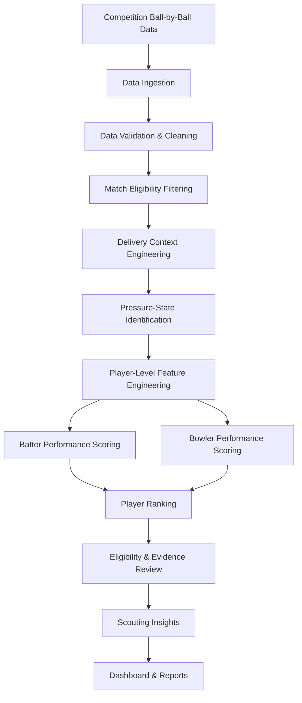

# 💎 RR GemHunters

<p align="center">
  <h3 align="center">Others See Stats. We Discover Stars.</h3>
  <p align="center">
    <strong>Cricket Talent Discovery & Auction Intelligence</strong>
    <br />
    An analytical scouting platform designed to identify undervalued, young and high-potential cricket talent.
  </p>
</p>

<p align="center">
  
  
  
  
  
</p>

---

## 🎯 About the Project

**RR GemHunters** is a data-driven cricket scouting and auction intelligence project developed for **SupeRR Selector Season 2**.

The goal is to go beyond conventional cricket statistics and identify promising players who may be overlooked by traditional performance-based selection methods.

The project explores player performance through batting and bowling indicators, pressure situations, consistency, sample size and match context to produce evidence-based scouting insights.

Rather than relying on a single statistic, RR GemHunters uses role-specific evaluation and comparative scoring to understand player contributions.

## 💎 Signature Innovation: Hidden Gem Detection Engine

Traditional player rankings often prioritize visible statistics. RR GemHunters aims to identify players whose overall value may be underestimated by conventional rankings.

### Oversight Gap

The Oversight Gap compares a player's conventional ranking with their context-adjusted ranking.

\[
OG = R_{\text{conventional}} - R_{\text{adjusted}}
\]

A positive Oversight Gap indicates that a player's position improves in the adjusted ranking.

This is a scouting signal, not proof of hidden talent. Each candidate should be reviewed using performance indicators, role, sample size and data reliability.

## 🚀 Key Features

| Feature | Description |
|---|---|
| 📊 Player Performance Intelligence | Analyse batting and bowling performance using relevant statistical indicators. |
| 🏏 Pressure Performance Analysis | Evaluate player contributions in high-pressure T20 chase situations. |
| 📈 Consistency & Reliability | Assess performance stability and account for limited sample sizes. |
| 💎 Hidden Gem Detection | Identify players whose adjusted ranking improves relative to conventional ranking. |
| 🎯 Role-Specific Evaluation | Evaluate batting and bowling contributions using separate scoring frameworks. |
| ⚖️ Smart Player Comparison | Compare players using role-specific and context-aware metrics. |
| 🔍 Eligibility & Evidence Checks | Consider pressure-delivery volume and match coverage when evaluating players. |
| 📊 Interactive Scouting Dashboard | Present player insights, comparisons, rankings and recommendations. |

*Additional capabilities such as age-adjusted potential, phase-level analysis, archetype classification and squad-fit analysis are planned extensions and will be implemented only when the available data supports them.*

## 🧮 Statistical & Analytical Framework

The project uses a structured analytical workflow involving:

- Data cleaning and validation
- Exploratory data analysis
- Feature engineering
- Descriptive statistics
- Percentile normalization
- Role-specific weighted scoring
- Pressure-performance evaluation
- Consistency and evidence analysis
- Eligibility filtering
- Ranking comparison and sensitivity analysis

### Pressure Batter Scoring Framework

The batter evaluation framework uses the following initial weights:

| Evaluation Dimension | Weight |
|---|---:|
| Scoring Ability | 30% |
| Consistency | 25% |
| Boundary Contribution | 15% |
| Dismissal Resistance | 15% |
| Evidence | 15% |
| **Total** | **100%** |

### Pressure Bowler Scoring Framework

The bowler evaluation framework uses:

| Evaluation Dimension | Weight |
|---|---:|
| Wickets per Match | 30% |
| Economy | 25% |
| Dot-Ball Percentage | 20% |
| Consistency | 15% |
| Evidence | 10% |
| **Total** | **100%** |

> **Scoring note:** These are relative, percentile-normalized evaluation scores. They are useful for comparing eligible players within the analysed dataset. They are not probabilities of winning, absolute measures of player quality or proof of future performance.

## 📊 Dataset & Analysis Scope

The current analysis covers:

- 139 competitions: 134 T20I and 5 IPL competitions
- 853 matches
- 837 matches with ball-by-ball data
- 16 abandoned matches excluded
- 200,999 source ball-by-ball rows
- 194,014 cleaned delivery rows

### Pressure Situation Definition

The current pressure-state analysis focuses on second-innings T20 chases.

A delivery is classified as a pressure situation when all three conditions hold:

- Required run rate is at least 10 runs per over.
- 30 or fewer balls remain.
- 5 or fewer wickets remain.

The analysis uses a standard 120-ball chase assumption. Matches with revised DLS targets are excluded from this pressure-state calculation.

> **Important limitation:** The pressure analysis focuses on qualifying second-innings chase situations. It does not represent every possible high-pressure situation in cricket.

## 🏏 Selected Player Shortlist

As part of the SupeRR Selector Season 2 competition submission, RR GemHunters shortlisted 20 players across batting and bowling categories.

### 🔥 Selected 10 Batters

| No. | Player |
|---:|---|
| 1 | David Miller |
| 2 | Rahul Tewatia |
| 3 | Glenn Maxwell |
| 4 | Rinku Singh |
| 5 | Matthew Wade |
| 6 | Rashid Khan |
| 7 | Cameron Green |
| 8 | Harry Brook |
| 9 | Dinesh Karthik |
| 10 | Tim David |

### 🎯 Selected 10 Bowlers

| No. | Player |
|---:|---|
| 1 | Mayank Yadav |
| 2 | Mark Adair |
| 3 | Glenn Maxwell |
| 4 | Jasprit Bumrah |
| 5 | Nasum Ahmed |
| 6 | Shaheen Afridi |
| 7 | Umesh Yadav |
| 8 | Saim Ayub |
| 9 | Gerald Coetzee |
| 10 | Joshua Little |

**Selection Note:** These are the players selected for the competition submission. Their inclusion represents the submitted scouting shortlist, not a claim that every player is an uncapped domestic prospect or a confirmed Rajasthan Royals recruitment recommendation.

## 🏗️ Project Architecture



## 🛠️ Tech Stack

| Category | Technologies |
|---|---|
| Programming Language | Python |
| Data Analysis | Pandas, NumPy, SciPy |
| Visualization | Matplotlib, Seaborn, Plotly |
| Machine Learning | Scikit-learn |
| Dashboard | Streamlit |
| Development Environment | VS Code, Jupyter Notebook |
| Version Control | Git, GitHub |

## 📁 Project Structure

```text
RR-GemHunters/
│
├── dashboard/
│
├── notebooks/
│
├── reports/
│
├── src/
│   ├── data/
│   ├── features/
│   ├── analytics/
│   ├── models/
│   └── evaluation/
│
├── tests/
│
├── .gitignore
├── README.md
└── requirements.txt
```

*The structure is representative of the project organization and will evolve as development continues.*

## 📅 Development Roadmap

- [x] Project initialization
- [x] Python virtual environment setup
- [x] Core dependency installation
- [x] Competition dataset understanding
- [x] Data cleaning and eligibility filtering
- [x] Pressure-state identification
- [x] Batter and bowler feature engineering
- [x] Role-specific pressure scoring
- [x] Initial player shortlist
- [ ] Final ranking validation
- [ ] Interactive scouting dashboard
- [ ] Final scouting report and presentation
- [ ] Further model validation and sensitivity analysis

## 🔐 Data Privacy & Responsible Use

- Competition data is handled according to the official challenge rules.
- Private or restricted competition data is not intended for publication in this repository.
- Public datasets and external sources are used only where permitted.
- Player recommendations are supported by statistical evidence.
- Sample-size constraints and data limitations are considered during evaluation.
- Relative scoring should not be interpreted as a guarantee of future performance.

## 👨‍💻 Developer

**Ankan Sen**

B.Tech | Computer Science & Engineering

- GitHub: [@AnkanXcoder](https://github.com/AnkanXcoder)

---

<p align="center">
  <strong>Every Hidden Gem Deserves a Chance to Shine. 💎</strong>
  <br />
  <sub>RR GemHunters | Cricket Talent Discovery & Auction Intelligence</sub>
</p>
