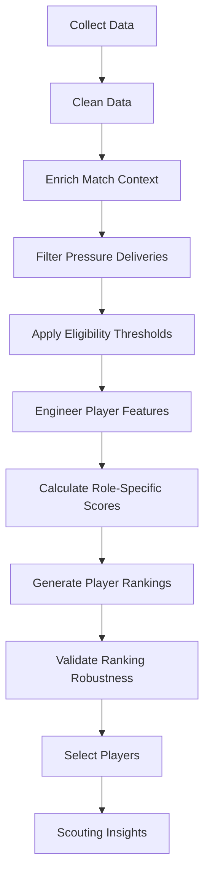

# 💎 RR GemHunters

<p align="center">
  <h3 align="center">Others See Stats. We Discover Stars.</h3>
  <p align="center">
    <strong>Pressure Performance Analysis & Player Selection</strong>
    <br />
    A data-led approach to identifying impact in high-pressure T20 cricket.
  </p>
</p>

<p align="center">
  
  
  
  
  
  
</p>

---

## 🎯 About the Project

**RR GemHunters** is a completed cricket analytics and player-selection project developed for **SupeRR Selector Season 2, Round 1**.

The objective is to identify players whose skills translate into decisive moments, not just overall match statistics.

Traditional season averages can hide how a player performs when the chase tightens, wickets fall or scoring pressure rises.

RR GemHunters addresses this problem through ball-by-ball match context, measurable pressure-state definitions and role-specific performance indicators.

Our approach evaluates:

- Batting performance under pressure
- Bowling effectiveness under pressure
- Scoring and finishing ability
- Wicket-taking and run prevention
- Match exposure and delivery sample size
- Performance consistency
- Player eligibility and ranking robustness

## 💎 Our Core Idea: Discover Impact Under Pressure

**Others See Stats. We Discover Stars.**

The project focuses on understanding how players perform in difficult T20 chase situations.

Rather than relying only on traditional season averages, we analyse the match situation before each delivery.

Three important contextual variables determine whether a delivery qualifies as a pressure delivery:

1. Required run rate
2. Balls remaining
3. Wickets remaining

These contextual variables are combined with player-level performance and evidence indicators to create separate batting and bowling evaluation frameworks.

## 🚀 Key Features

| Feature | Description |
|---|---|
| Ball-by-Ball Analysis | Analyse individual deliveries with match and innings context. |
| Pressure-State Detection | Identify difficult second-innings chase situations using measurable conditions. |
| Batter Performance Scoring | Evaluate scoring, consistency, boundary involvement, dismissal resistance and evidence. |
| Bowler Performance Scoring | Evaluate wicket-taking, economy, dot-ball percentage, consistency and evidence. |
| Player Eligibility Filtering | Apply minimum pressure-delivery and match requirements. |
| Ranking Robustness | Compare player rankings under primary and strict eligibility thresholds. |
| Player Selection | Build a selected group of 10 batters and 10 bowlers. |
| Evidence-Based Scouting | Consider match exposure, delivery samples and consistency instead of relying on raw averages alone. |

## 🏗️ Analytical Workflow

The project follows a reproducible workflow built around ball-by-ball data and match context.



### Workflow Steps

1. **Collect:** Ball-by-ball records, matches, competitions, teams and player mappings.
2. **Clean:** Standardise deliveries, innings, extras, wickets and player identities.
3. **Enrich:** Attach match context and calculate pre-delivery chase state.
4. **Filter:** Identify pressure deliveries and apply minimum evidence thresholds.
5. **Score:** Calculate role-specific components, composite scores and ranks.

## 📊 Dataset & Data Audit

The project analysis covers:

| Dataset Metric | Value |
|---|---:|
| Total Competitions | 139 |
| T20I Competitions | 134 |
| IPL Competitions | 5 |
| Total Matches | 853 |
| Matches with Ball-by-Ball Coverage | 837 |
| Cleaned Delivery Records | 194,014 |
| Pressure-State Delivery Records | 88,035 |
| Eligible Second Innings | 770 |

The dataset was processed to create delivery-level match context and identify qualifying pressure situations.

## ⚡ Pressure-State Definition

The current operational definition focuses on difficult second-innings T20 chase situations.

A delivery is classified as a pressure delivery when **all three conditions** are true:

| Pressure Indicator | Condition |
|---|---|
| Required Run Rate | ≥ 10 runs per over |
| Balls Remaining | ≤ 30 legal balls |
| Wickets Remaining | ≤ 5 wickets |

All conditions are joined using the logical **AND** operator.

```python
is_pressure = (
    (required_run_rate >= 10) &
    (balls_remaining <= 30) &
    (wickets_remaining <= 5)
)
```

A delivery that fails any one of these conditions is outside the pressure filter.

### Pressure Dataset

- 88,035 pressure delivery states
- 770 eligible second innings

The analysis focuses on second-innings chases and uses a standard 120-ball assumption. Revised-target/DLS cases are excluded.

## 🏏 Batter Evaluation Framework

The batting evaluation framework combines five weighted dimensions to measure output, repeatability and evidence.

| Evaluation Dimension | Weight | Measurement |
|---|---:|---|
| Pressure Scoring | 30% | Overall pressure strike rate |
| Consistency | 25% | Median match strike rate and lower match-to-match variation |
| Boundary Involvement | 15% | Share of matches with boundary involvement |
| Dismissal Resistance | 15% | Lower dismissals per 100 balls |
| Evidence Strength | 15% | Pressure matches and pressure deliveries |
| **Total** | **100%** | |

Scores are percentile-based within the primary-eligible batter population.

## 🎯 Bowler Evaluation Framework

The bowling evaluation framework rewards wicket impact, control and repeatability.

| Evaluation Dimension | Weight | Measurement |
|---|---:|---|
| Wicket-Taking | 30% | Average wickets per pressure match |
| Economy Control | 25% | Lower pressure economy |
| Dot-Ball Pressure | 20% | Higher pressure dot-ball percentage |
| Consistency | 15% | Lower match-to-match economy variation |
| Evidence Strength | 10% | Pressure matches and pressure deliveries |
| **Total** | **100%** | |

A quality review is flagged when more than 5% of a bowler's pressure deliveries carry quality flags.

## 🔍 Eligibility & Ranking Robustness

Minimum evidence requirements reduce over-reliance on very small samples.

| Eligibility Tier | Pressure Deliveries | Matches |
|---|---:|---:|
| Primary | ≥ 20 | ≥ 5 |
| Relaxed | ≥ 10 | ≥ 3 |
| Strict | ≥ 30 | ≥ 8 |

### Batter Eligibility

| Metric | Result |
|---|---:|
| Primary Eligible | 96 |
| Strict Eligible | 46 |
| Primary Top 10 Retained in Strict Top 10 | 8 of 10 |

### Bowler Eligibility

| Metric | Result |
|---|---:|
| Primary Eligible | 88 |
| Strict Eligible | 52 |
| Primary Top 10 Retained in Strict Top 10 | 4 of 10 |

Sensitivity scores are recalculated within the strict group.

Because percentile reference populations differ, ranking membership is compared rather than raw score values.

## 🔥 Selected Batter Group

The submitted batting group combines finishers, middle-order power and flexible all-round options.

| No. | Selected Batter | Player Profile |
|---:|---|---|
| 1 | **David Miller** | Left-handed finisher; experience in high-pressure closing roles. |
| 2 | **Rahul Tewatia** | Lower-order hitter known for late-innings acceleration. |
| 3 | **Glenn Maxwell** | Explosive middle-order batter with off-spin utility. |
| 4 | **Rinku Singh** | Finisher with a strong record of late-innings impact. |
| 5 | **Matthew Wade** | Left-handed batter with experience in aggressive T20 roles. |
| 6 | **Rashid Khan** | Power-hitting lower-order all-round option. |
| 7 | **Cameron Green** | Batting depth and pace-bowling versatility. |
| 8 | **Harry Brook** | Middle-order stroke-maker with multi-format experience. |
| 9 | **Dinesh Karthik** | Specialist finisher and experienced T20 batter. |
| 10 | **Tim David** | Power hitter suited to high-impact finishing roles. |

## 🎯 Selected Bowling Group

The submitted bowling group combines pace, spin, variation and all-round match-up options.

| No. | Selected Bowler | Player Profile |
|---:|---|---|
| 1 | **Mayank Yadav** | Express pace option; can challenge batters with speed. |
| 2 | **Kuldeep Yadav** | Left-arm wrist spin; wicket-taking variation in middle overs. |
| 3 | **Glenn Maxwell** | Off-spin option and matchup flexibility. |
| 4 | **Yuzvendra Chahal** | Attacking leg-spin and middle-over wicket threat. |
| 5 | **Shardul Thakur** | Seam-bowling option with lower-order batting contribution. |
| 6 | **Jasprit Bumrah** | High-skill pace bowler with yorkers and varied release points. |
| 7 | **Gerald Coetzee** | Aggressive fast bowler with pace and bounce. |
| 8 | **Jamie Overton** | Seam-bowling all-round option with pace and batting depth. |
| 9 | **Adil Rashid** | Leg-spin variation and wicket-taking threat. |
| 10 | **Rashid Khan** | Fast leg-spin, control and lower-order batting value. |

**Multi-skill options:** Glenn Maxwell and Rashid Khan appear in both groups because of their contributions across batting and bowling.

## 🧰 Technology & Tools

The project uses a Python-based data analysis workflow.

| Category | Tools |
|---|---|
| Programming Language | Python |
| Data Manipulation | Pandas, NumPy |
| Statistical Analysis | SciPy |
| Machine Learning / Analytics | Scikit-learn |
| Data Visualization | Matplotlib, Seaborn, Plotly |
| Dashboard | Streamlit |
| Development Environment | VS Code, Jupyter Notebook |
| Version Control | Git and GitHub |

## 📁 Project Structure

```text
RR-GemHunters/
│
├── dashboard/
│
├── data/
│
├── notebooks/
│
├── reports/
│
├── src/
│
├── tests/
│
├── .gitignore
├── README.md
└── requirements.txt
```

## 📌 What the Analysis Can and Cannot Claim

### What It Does

- Measures defined second-innings chase pressure.
- Evaluates role-specific batting and bowling indicators.
- Compares eligible players using percentile-based composite scores.
- Uses match and delivery evidence to assess eligibility.
- Checks ranking robustness using stricter evidence requirements.

### What It Does Not Claim

- It is not a calibrated win-probability model.
- It does not cover every possible pressure scenario.
- It does not establish auction registration or player availability.
- It does not prove that a player will perform similarly in future matches.

### Important Limitations

1. **Second-Innings Chase Focus:** First-innings defending pressure is outside the current operational filter.
2. **120-Ball Assumption:** A standard legal-ball limit is used; revised-target/DLS cases are excluded.
3. **Relative Scores:** Percentile scores describe position within the eligible player pool, not an absolute probability of success.
4. **Sample Uncertainty:** Primary and strict eligibility results should be interpreted alongside matches and pressure deliveries.
5. **Competition Effects:** No explicit IPL-versus-T20I adjustment or empirical-Bayes shrinkage is implemented in the current scoring scripts.

## 📅 Project Completion Status

<badge color="success">Completed</badge> <badge color="success">Round 1 Submitted</badge>

- [x] Project initialization
- [x] Competition dataset collection and understanding
- [x] Data cleaning and validation
- [x] Match context engineering
- [x] Pressure-state identification
- [x] Batter feature engineering
- [x] Bowler feature engineering
- [x] Batter scoring framework
- [x] Bowler scoring framework
- [x] Eligibility and evidence thresholds
- [x] Ranking robustness analysis
- [x] Selected group of 10 batters
- [x] Selected group of 10 bowlers
- [x] Round 1 presentation
- [x] Round 1 submission

**Project:** RR GemHunters  
**Competition:** SupeRR Selector Season 2  
**Round:** 1  
**Status:** Completed and Submitted

## 🔐 Data Privacy & Responsible Use

- Competition data is handled according to the official challenge rules.
- Private or restricted competition data is not intended for publication in this repository.
- Public datasets and external sources are used only where permitted.
- Player evaluations are based on the available statistical evidence.
- Sample-size constraints and data limitations are considered during evaluation.
- Relative scores should not be interpreted as guarantees of future performance.

## 👨‍💻 Developer

**Ankan Sen**

B.Tech | Computer Science & Engineering

- GitHub: [@AnkanXcoder](https://github.com/AnkanXcoder)

---

<p align="center">
  <strong>Every Hidden Gem Deserves a Chance to Shine. 💎</strong>
  <br />
  <sub>RR GemHunters | SupeRR Selector Season 2 | Round 1</sub>
</p>
